# Mapa de cola

Qué hace la cola, dónde corre cada parte y qué conecta con qué. Copia pública, generada con `python3 docs/mapa.py --publico` a partir del código de un repo privado; sin las llaves ni el nombre de las máquinas.

| **14** | **8** | **10** | **5** | **3** | **27** |
|:---:|:---:|:---:|:---:|:---:|:---:|
| rutas | alias | cuentas | CLIs | máquinas | órdenes |

**Índice**: [Piezas y dónde viven](#piezas-y-dónde-viven) · [Un trabajo](#un-trabajo) · [El tic](#el-tic) · [Elección de ruta](#elección-de-ruta) · [Catálogo](#catálogo) · [Consultas](#consultas) · [Webs por el navegador](#webs-por-el-navegador) · [Agentes en el VPS](#agentes-en-el-vps) · [GitHub Actions](#github-actions) · [Estado compartido](#estado-compartido) · [Código](#código)

## Piezas y dónde viven

La cola reparte peticiones a modelos entre tres máquinas, según la cuota de cada cuenta. El código vive en `thendabs1/cola` y el estado en `thendabs1/cola-datos`, que hace de bus: cada máquina hace pull antes de su tic y push después. Colores: azul, el portátil; naranja, el VPS; violeta, los runners de Actions; verde, GitHub; gris, lo de fuera; amarillo, tú.

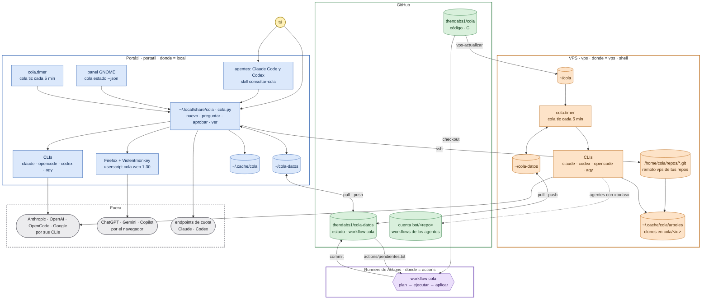

| Máquina | nombre | donde | CLIs | Además | Qué hace |
|---|---|---|---|---|---|
| **Portátil** | `portatil` | `local` | claude · opencode · codex · agy | llega al VPS por SSH (`vps`); webs en el perfil de Firefox «default» | Donde trabajas: creas y apruebas trabajos, preguntas al momento y usas las webs por Firefox. Su tic corre los trabajos «local» y «cualquiera», y lee la cuota de Claude, Codex y agy y la publica para las demás. |
| **VPS** | `vps` | `vps` | claude · codex · opencode · agy | `shell = true`: agentes con «todas»; `github`: `gh` como la cuenta bot | Siempre encendido (1 CPU, ~1 GB): su tic corre los trabajos «vps» y «cualquiera», también de noche, y los agentes con shell («todas»). |
| **Runners de Actions** | `actions` | `actions` | — | — | Los jobs plan y aplicar del workflow cola: pasos de tipo comando de los trabajos «actions». Sin CLIs de modelos ni cuentas. |

Ejemplos en `maquina.ejemplo.toml`, `maquina.vps.ejemplo.toml`, `maquina.actions.toml`. Cada máquina tiene el suyo en `~/.config/cola/maquina.toml`, fuera de cualquier repo: dice dónde están sus binarios y sus credenciales.

## Un trabajo

`cola nuevo` deja un trabajo en cola-datos; cualquier tic que pueda correrlo lo coge, paso a paso, y cada paso deja su salida y su línea en el registro. `cola preguntar` es el atajo sin trabajo (ver «Consultas»).

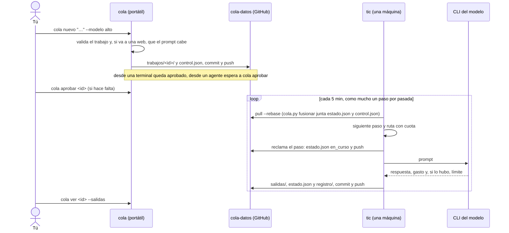

El estado del trabajo sale de los de sus pasos (`estado_de`). Se mira en este orden: cancelado, inválido, sin aprobar, pausado y, si no, el peor de sus pasos.

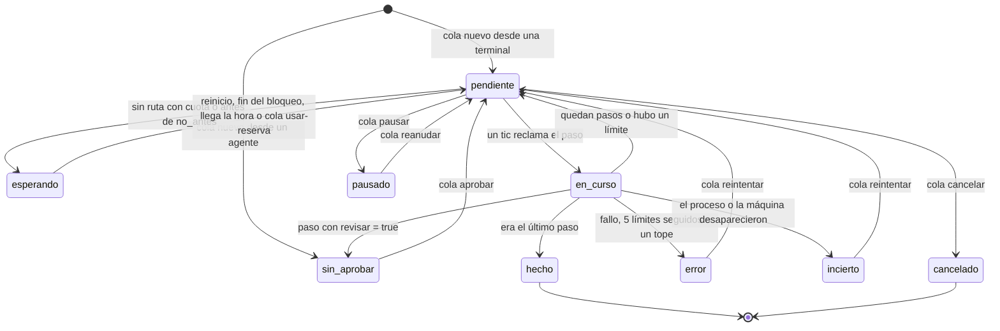

Los 10 estados, los 6 tipos de paso, las prioridades y dónde corre

| Estado | Cuándo |
|---|---|
| `cancelado` | `cola cancelar`: no vuelve a correr |
| `invalido` | `trabajo.toml` no pasa la validación |
| `sin_aprobar` | sin aprobar, cambiado después de aprobarlo, o con un paso «revisar» hecho que aún no has visto |
| `pausado` | `cola pausar` |
| `error` | un paso falló o llegó a un tope; `cola reintentar` |
| `incierto` | el proceso murió o su máquina no volvió: pudo gastar cuota; `cola reintentar` |
| `en_curso` | una máquina ejecuta un paso |
| `esperando` | un paso espera cuota, el fin de un bloqueo o su hora (`no_antes`) |
| `pendiente` | le toca al siguiente tic que pueda correrlo |
| `hecho` | todos los pasos hechos |

| Tipo de paso | Qué hace |
|---|---|
| `normal` | un prompt, una respuesta |
| `planificar` | responde un JSON con subconsultas (esquema fijo) en `salidas/<paso>.json` |
| `abanico` | una llamada por subconsulta del plan, una por tic (hasta 8) |
| `sintetizar` | junta las salidas de los pasos que usa: es el paso `contraste` de `--contrastar` |
| `revisar` | revisa otra salida y acaba en APROBADO o CAMBIOS: es el paso `revision` de `--revisar` |
| `comando` | una orden de shell, solo en GitHub Actions (`--comando`) |

| Prioridad | Qué significa |
|---|---|
| `alta` | va primero y corre aunque no se haya podido leer la cuota (es la de `preguntar` y `despertar`) |
| `normal` | la de siempre |
| `relleno` | solo con cuota leída y cerca de un reinicio, para aprovechar lo que sobra de la ventana |

| donde | Quién lo coge |
|---|---|
| `cualquiera` | la primera que lo reclame (push de su `estado.json`) |
| `local` | solo el portátil |
| `vps` | solo el VPS (los de `--herramientas`) |
| `actions` | solo GitHub Actions (los de `--comando`) |

## El tic

Lo lanza `cola.timer` cada 5 min en el portátil y en el VPS; `cola.service` lo corta a los 330 min. Ejecuta como mucho un paso por pasada y, mientras ese paso corre, el tic de esa máquina no hace nada más.

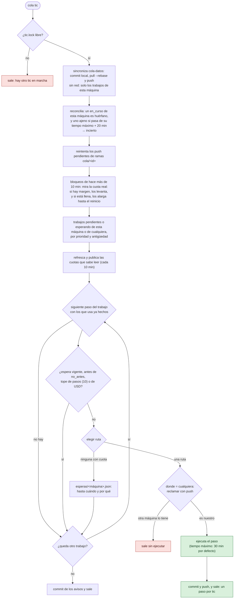

## Elección de ruta

Un paso pide un alias (`alto`, `bajo`…) o una ruta. `catalogo.elegir` descarta las rutas que no sirven y toma la primera que tenga cuota. Las cifras son las de por defecto; `config.toml` de cola-datos las cambia por cuenta.

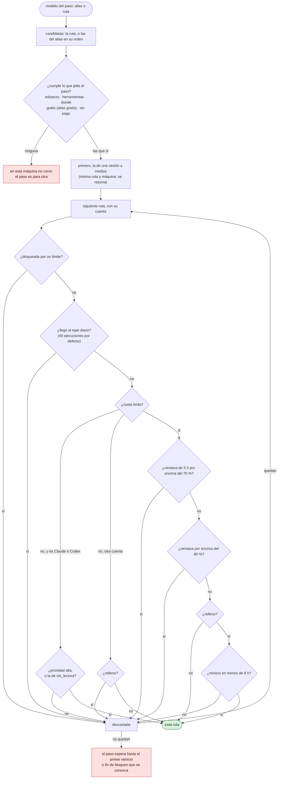

**De dónde sale la cuota.** De una lectura propia, que se guarda 10 min y caduca tras cada paso con la cuenta. Si aquí no se puede leer (el VPS con `setup-token`), vale la que otra máquina publicó en `cuotas/<máquina>.json` si tiene menos de 15 min y es posterior al último paso con esa cuenta. Tras un límite la cuenta queda bloqueada hasta la hora que da el CLI (o 1 h si no la da; 10 min si es saturación del servidor y no el límite de la cuenta, que tampoco cuenta para los 5 límites seguidos que dan el paso por error); pasados 10 min, cada tic mira la cuota real: levanta el bloqueo si hay margen o lo alarga hasta el reinicio de la ventana llena. Uno de más de 6 h (la fecha de un límite semanal, que puede ser el de un modelo) no lo toca. `cola preguntar` elige igual, con prioridad alta.

## Catálogo

De `modelos.toml`: 14 rutas (CLI, cuenta y modelo) en 10 cuentas, y 8 alias. Un alias es una lista ordenada de rutas; el número de cada flecha es su puesto. Las webs solo están en `juez`; si no, se piden por su ruta. En verde azulado, las rutas que corren en el portátil y en el VPS; en azul, solo en el portátil.

```mermaid
flowchart LR
  accTitle: Catálogo
  a_alto(["alto"]):::tu
  a_medio(["medio"]):::tu
  a_bajo(["bajo"]):::tu
  a_gratis(["gratis"]):::tu
  a_revisor(["revisor"]):::tu
  a_juez(["juez"]):::tu
  a_verificador(["verificador"]):::tu
  a_verificador_confianza(["verificador_confianza"]):::tu
  r_claude_pro_opus["claude-pro-opus<br>opus"]:::ambas
  r_claude_team_opus["claude-team-opus<br>opus"]:::ambas
  r_claude_pro_haiku["claude-pro-haiku<br>haiku"]:::ambas
  r_claude_team_haiku["claude-team-haiku<br>haiku"]:::ambas
  r_opencode_beam["opencode-beam<br>opencode/beam-free"]:::ambas
  r_opencode_mimo["opencode-mimo<br>opencode/mimo-v2.6-flash-free"]:::ambas
  r_codex_sol["codex-sol<br>gpt-6.1-sol"]:::ambas
  r_agy_flash["agy-flash<br>gemini-3.8-flash-medium"]:::ambas
  r_agy_flash_high["agy-flash-high<br>gemini-3.8-flash-high"]:::ambas
  r_agy_opus["agy-opus<br>claude-opus-4-6-thinking"]:::ambas
  r_chatgpt_web["chatgpt-web<br>web"]:::portatil
  r_gemini_web["gemini-web<br>web"]:::portatil
  r_copilot_web["copilot-web<br>web"]:::portatil
  r_deepseek_web["deepseek-web<br>web"]:::portatil
  c_claude_pro{{"claude-pro<br>claude"}}:::fuera
  c_claude_team{{"claude-team<br>claude"}}:::fuera
  c_opencode{{"opencode<br>opencode"}}:::fuera
  c_codex{{"codex<br>codex"}}:::fuera
  c_antigravity{{"antigravity<br>agy"}}:::fuera
  c_antigravity_claude{{"antigravity-claude<br>agy"}}:::fuera
  c_chatgpt{{"chatgpt<br>web"}}:::fuera
  c_gemini_web{{"gemini-web<br>web"}}:::fuera
  c_copilot_web{{"copilot-web<br>web"}}:::fuera
  c_deepseek_web{{"deepseek-web<br>web"}}:::fuera
  a_alto -->|"1"| r_claude_pro_opus
  a_alto -->|"2"| r_claude_team_opus
  a_alto -->|"3"| r_agy_opus
  a_medio -->|"1"| r_agy_flash_high
  a_medio -->|"2"| r_codex_sol
  a_medio -->|"3"| r_claude_pro_haiku
  a_bajo -->|"1"| r_agy_flash
  a_bajo -->|"2"| r_claude_pro_haiku
  a_bajo -->|"3"| r_claude_team_haiku
  a_bajo -->|"4"| r_opencode_beam
  a_gratis -->|"1"| r_opencode_beam
  a_gratis -->|"2"| r_opencode_mimo
  a_revisor -->|"1"| r_codex_sol
  a_revisor -->|"2"| r_claude_team_opus
  a_revisor -->|"3"| r_claude_pro_opus
  a_juez -->|"1"| r_claude_pro_opus
  a_juez -->|"2"| r_claude_team_opus
  a_juez -->|"3"| r_codex_sol
  a_juez -->|"4"| r_agy_opus
  a_juez -->|"5"| r_gemini_web
  a_juez -->|"6"| r_chatgpt_web
  a_juez -->|"7"| r_copilot_web
  a_verificador -->|"1"| r_claude_pro_opus
  a_verificador -->|"2"| r_claude_team_opus
  a_verificador -->|"3"| r_agy_opus
  a_verificador_confianza -->|"1"| r_codex_sol
  a_verificador_confianza -->|"2"| r_claude_pro_opus
  a_verificador_confianza -->|"3"| r_claude_team_opus
  a_verificador_confianza -->|"4"| r_agy_opus
  r_claude_pro_opus --> c_claude_pro
  r_claude_team_opus --> c_claude_team
  r_claude_pro_haiku --> c_claude_pro
  r_claude_team_haiku --> c_claude_team
  r_opencode_beam --> c_opencode
  r_opencode_mimo --> c_opencode
  r_codex_sol --> c_codex
  r_agy_flash --> c_antigravity
  r_agy_flash_high --> c_antigravity
  r_agy_opus --> c_antigravity_claude
  r_chatgpt_web --> c_chatgpt
  r_gemini_web --> c_gemini_web
  r_copilot_web --> c_copilot_web
  r_deepseek_web --> c_deepseek_web
  classDef tu fill:#fff1b8,stroke:#9a7b00,color:#3d3000
  classDef portatil fill:#dbe8fb,stroke:#2f62b3,color:#0f2a55
  classDef vps fill:#fde3c8,stroke:#b8620b,color:#4a2600
  classDef ambas fill:#d5ecee,stroke:#2f7f88,color:#0f3337
  classDef actions fill:#ebdffb,stroke:#6b3fb3,color:#2b1250
  classDef github fill:#d9f0dc,stroke:#2e7d43,color:#123d1d
  classDef fuera fill:#ececee,stroke:#6b6b74,color:#222226
  classDef si fill:#d9f0dc,stroke:#2e7d43,color:#123d1d
  classDef no fill:#fbe0de,stroke:#b3423b,color:#4a1210
```

Las 14 rutas

| Ruta | CLI | Cuenta | Modelo | Esfuerzos | Herramientas | Cobro | Dónde | Roles | En los alias |
|---|---|---|---|---|---|---|---|---|---|
| `claude-pro-opus` | `claude` | `claude-pro` | `opus` | low, medium, high, xhigh, max | ninguna, lectura, edicion, todas | suscripcion | local, vps | diseñar, revisar, sintetizar | alto, revisor, juez, verificador, verificador_confianza |
| `claude-team-opus` | `claude` | `claude-team` | `opus` | low, medium, high, xhigh, max | ninguna, lectura, edicion, todas | suscripcion | local, vps | diseñar, revisar, sintetizar | alto, revisor, juez, verificador, verificador_confianza |
| `claude-pro-haiku` | `claude` | `claude-pro` | `haiku` | — | ninguna, lectura, edicion, todas | suscripcion | local, vps | resumir, clasificar | medio, bajo |
| `claude-team-haiku` | `claude` | `claude-team` | `haiku` | — | ninguna, lectura, edicion, todas | suscripcion | local, vps | resumir, clasificar | bajo |
| `opencode-beam` | `opencode` | `opencode` | `opencode/beam-free` | — | ninguna | gratis | local, vps | investigar, resumir | bajo, gratis |
| `opencode-mimo` | `opencode` | `opencode` | `opencode/mimo-v2.6-flash-free` | — | ninguna | gratis | local, vps | investigar, resumir | gratis |
| `codex-sol` | `codex` | `codex` | `gpt-6.1-sol` | low, medium, high, xhigh | ninguna, todas | suscripcion | local, vps | revisar, diseñar, editar | medio, revisor, juez, verificador_confianza |
| `agy-flash` | `agy` | `antigravity` | `gemini-3.8-flash-medium` | — | ninguna, lectura, edicion | suscripcion | local, vps | investigar, resumir, clasificar | bajo |
| `agy-flash-high` | `agy` | `antigravity` | `gemini-3.8-flash-high` | — | ninguna, lectura, edicion | suscripcion | local, vps | investigar, sintetizar | medio |
| `agy-opus` | `agy` | `antigravity-claude` | `claude-opus-4-6-thinking` | — | ninguna, lectura, edicion | suscripcion | local, vps | diseñar, revisar, sintetizar | alto, juez, verificador, verificador_confianza |
| `chatgpt-web` | `web` | `chatgpt` | `web` | — | ninguna | suscripcion | local | revisar, investigar | juez |
| `gemini-web` | `web` | `gemini-web` | `web` | — | ninguna | suscripcion | local | revisar, investigar | juez |
| `copilot-web` | `web` | `copilot-web` | `web` | — | ninguna | suscripcion | local | revisar, investigar | juez |
| `deepseek-web` | `web` | `deepseek-web` | `web` | — | ninguna | suscripcion | local | revisar, investigar | — |

| CLI | Cómo se lanza |
|---|---|
| `claude` | `claude -p --output-format json`, sin MCP (`--strict-mcp-config`) ni órdenes con barra |
| `codex` | `codex exec --json --ignore-user-config`: sandbox read-only y sin shell, o todo con «todas» |
| `opencode` | `opencode run --standalone --format json`, con el prompt como argumento |
| `agy` | `agy --model … --output-format json`, con el prompt como argumento |
| `web` | Firefox `--new-tab` y el userscript `web/cola-web.user.js` en Violentmonkey |

## Consultas

`cola preguntar` corre ya en esta máquina y espera la respuesta; `cola nuevo` deja un trabajo que corre cuando haya cuota, quizá en otra máquina. Las dos montan el prompt igual, en este orden (cada pieza solo si toca):

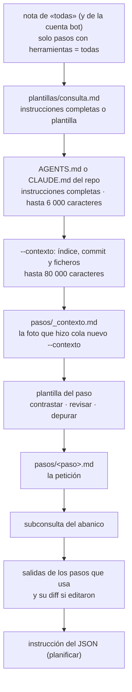

| instrucciones | Qué va delante |
|---|---|
| `auto` | `completas` si el paso lleva contexto; si no, `ninguna`, para que las consultas ligeras no paguen nada |
| `completas` | `plantillas/consulta.md` y el `AGENTS.md` o `CLAUDE.md` del repo, recortado |
| `plantilla` | solo `plantillas/consulta.md` |
| `ninguna` | nada |
| con herramientas | nada: el CLI ya lee el repo y su `AGENTS.md` |

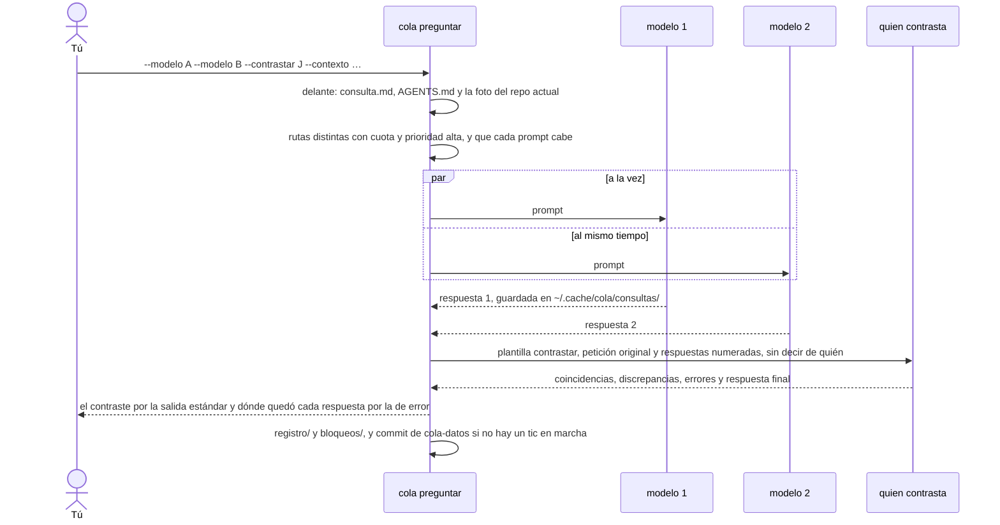

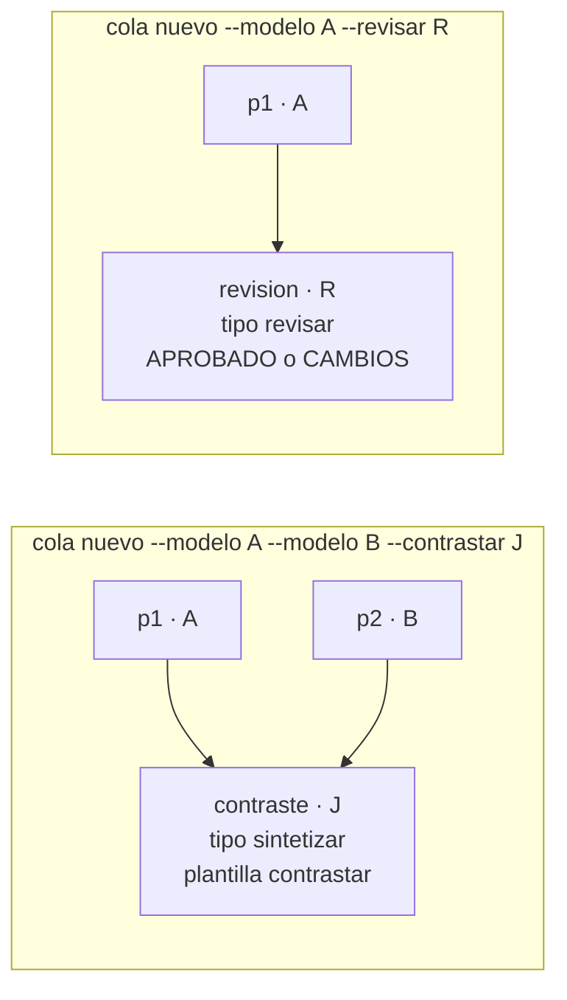

|  | `cola preguntar` | `cola nuevo` |
|---|---|---|
| Cuándo corre | ya, en esta máquina | cuando un tic lo coja y haya cuota |
| Prioridad | alta | la del trabajo |
| Aprobación | no hace falta: lo que manda está acotado a `--contexto` | desde una terminal, aprobado; desde un agente, `cola aprobar` |
| Varios modelos | a la vez, y el contraste al final | pasos `p1`…`pN` y `contraste`, uno por tic |
| Revisión | — | `--revisar MODELO`: paso `revision` |
| Herramientas | nunca | `--herramientas`, en el VPS |
| Respuesta | salida estándar y `~/.cache/cola/consultas/` | `salidas/` (`cola ver <id> --salidas`) |
| Si una web no cabe | falla antes de abrir ninguna | falla al crear el trabajo, no al correr |

Topes del prompt: `--contexto` hasta 80 000 caracteres; una web admite 100 000 en total, y si contrasta o revisa se guardan 20 000 por respuesta que juzga. El de `cola revisar` recorta el diff según la ruta que lo lea: 100 000 a una web, 90 000 a agy u OpenCode (argumento) y 300 000 a Claude o Codex (stdin).

## Webs por el navegador

Rutas `chatgpt-web`, `gemini-web`, `copilot-web` y `deepseek-web`: solo en el portátil, con Firefox abierto. El prompt no viaja en la URL: la pestaña solo lleva el puerto y una clave tras `#`, que el navegador no manda a la web. Las pestañas escriben de una en una y esperan su respuesta a la vez.

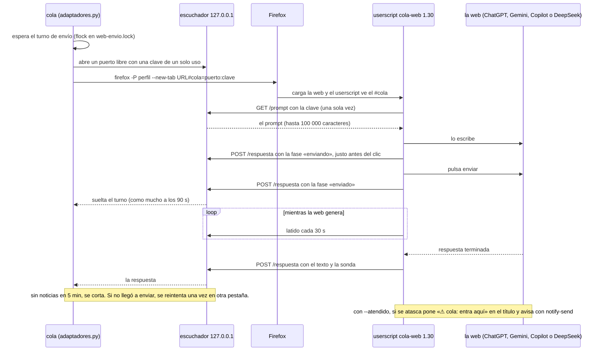

- Si una web cambia su HTML, el userscript devuelve un error con diagnóstico y deja una **sonda** en `~/.cache/cola/sondas/` (qué casa con cada selector, el HTML de la respuesta y del cuadro, y cuándo pasó cada fase). `cola web-prueba` manda una respuesta conocida a cada web y dice si se leyó bien.
- Reintento: solo si la pestaña pidió el prompt pero no avisó «enviando» (justo antes del clic) y quedan al menos 1 min. Después de enviar no se repite: sería pagar dos veces.
- `cola preguntar` espera a una web al menos 60 min; los latidos permiten cortar antes si la pestaña se cae.
- Sin ventana (#36): con `[chatgpt] sin_ventana = "perfil"`, cada consulta abre una ventana en un Firefox headless de ese perfil, que lanza la primera y sigue corriendo; las ventanas no se frenan como las pestañas ocultas y el userscript las cierra al acabar. `--atendido` va al perfil de siempre.
- `cola web-instalar` abre el userscript del árbol desde el que se lanza, para instalarlo o probar una rama en Violentmonkey (`--sin-ventana`: en el perfil sin ventana, cerrando antes su Firefox headless). `web/sin_ventana.py html|prueba RUTA` abre la web en un Firefox sin ventana con una copia de la sesión: saca el HTML o corre el userscript con la prueba de `web-prueba` (no vale para Copilot).
- `chatgpt/chatgpt-cola.user.js` (2.4) queda solo para `chatgpt -y` desde la terminal.

## Agentes en el VPS

Para dejarle una tarea a Claude o a Codex con el repo delante, sin mandar contexto. Solo viaja lo que tiene commit. El VPS no tiene ninguna credencial de tu cuenta de GitHub; si tiene la de la cuenta bot, el agente puede correr sus propios workflows en la copia del repo que hay allí.

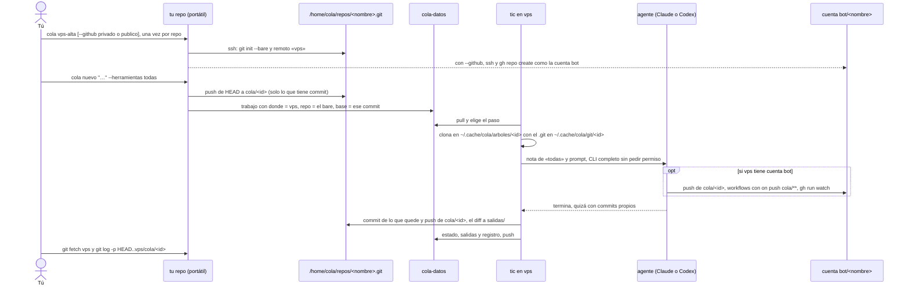

| --herramientas | Quién | Qué puede hacer |
|---|---|---|
| `lectura` | Claude | Read, Grep, Glob en el clon, sin shell |
| `edicion` | Claude | además edita; commit y push los hace la cola (nunca main, nunca `--force`) |
| `todas` | Claude o Codex, solo con `shell = true` | el CLI completo: shell, tests, red y el git del clon, durante el tiempo del paso (hasta 300 min con `--tiempo-max`) |

Para poner el código al día después de fusionar en `main`, sin cortar un tic a medias. `cola actualizar` lo hace en las dos máquinas, una detrás de otra: si una falla, la otra sigue y avisa del desfase; si cambió la `@version` del userscript, avisa de que hay que lanzar `cola web-instalar`:

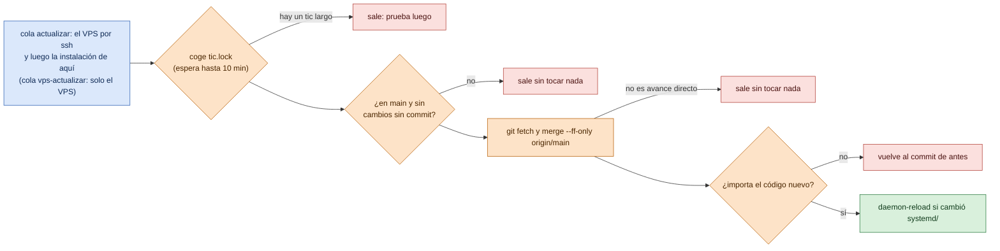

## GitHub Actions

Para órdenes de shell (`cola nuevo --comando "pytest -q"`), que nunca corren en el portátil ni en el VPS. Un paso por vuelta, en tres jobs; solo `aplicar` escribe, y no ejecuta nada del trabajo. Cada paso corre en un runner nuevo: lo que necesite del anterior va en un solo comando.

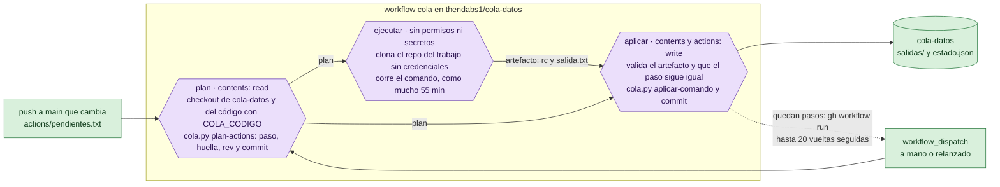

Disparadores (leídos del workflow): `push`, `workflow_dispatch`. El repo del trabajo ha de ser una URL `https://` pública y `base` una rama, una etiqueta o un commit de 40 caracteres.

## Estado compartido

Cada fichero de cola-datos tiene un solo tipo de escritor, para que no se pierdan órdenes ni se ejecute un paso dos veces. Los que dos máquinas pueden tocar a la vez los fusiona git con `cola.py fusionar`: en un paso gana el `rev` mayor, dos reclamaciones a la vez son un conflicto (pierde la que publica después) y, entre dos órdenes, gana la prudente.

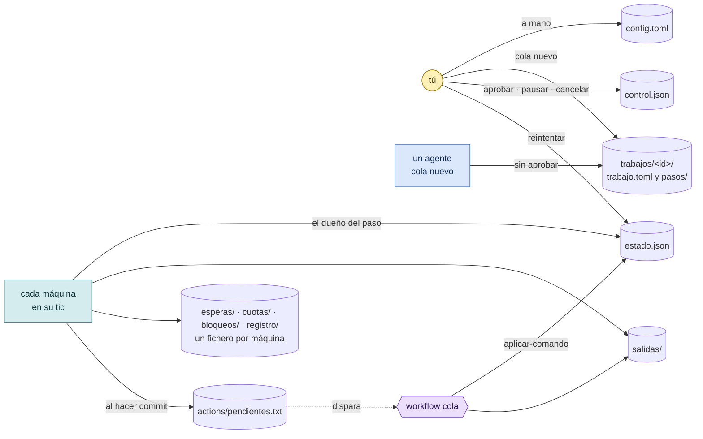

| En `~/cola-datos` | Lo escribe | Para qué | Al fusionar |
|---|---|---|---|
| `config.toml` | tú, a mano | reservas, tope diario, ventana de relleno y `sin_lectura` por cuenta; tiempo máximo por paso | git, sin más |
| `trabajos/<id>/trabajo.toml` | `cola nuevo` (tú o un agente) o a mano | el trabajo y sus pasos; su huella es lo que apruebas | git, sin más |
| `trabajos/<id>/pasos/` | `cola nuevo` o a mano | el prompt de cada paso; `_contexto.md`, la foto de `--contexto` | git, sin más |
| `trabajos/<id>/control.json` | tus órdenes: aprobar, pausar, cancelar (el tic, nunca) | si el trabajo puede correr | `cola.py fusionar` |
| `trabajos/<id>/estado.json` | la máquina dueña de cada paso, que sube su `rev`; `cola reintentar` | estado, ruta, máquina, intentos, gasto y rama de cada paso | `cola.py fusionar` |
| `trabajos/<id>/salidas/` | la máquina que ejecutó el paso | respuestas; `.diff` de los pasos que editan; `.json` del plan | git, sin más |
| `esperas/<máquina>.json` | cada máquina, la suya | por qué y hasta cuándo espera allí un paso | un fichero por máquina |
| `codigo/<máquina>.json` | el tic de cada máquina, al empezar, si cambió | el commit del código que corre y si tiene cambios sin commit: `cola estado` y `cola seguir` avisan si no coinciden (#13) | un fichero por máquina |
| `cuotas/<máquina>.json` | cada máquina que sabe leer una cuota | la cuota de Claude, Codex y agy para las que no saben | un fichero por máquina |
| `cuotas/historial/<día>-<máquina>.jsonl` | cada máquina que sabe leer una cuota, al cambiar la lectura | la historia de las cuotas de Claude, Codex y agy (#101) | un fichero por máquina |
| `bloqueos/<máquina>.json` | cada máquina, la suya | cuentas que dieron un límite: hasta cuándo, y si se levantó | un fichero por máquina |
| `registro/<día>-<máquina>.jsonl` | cada máquina, la suya | una línea por llamada: ruta, resultado, gasto, duración, cuota antes y después | un fichero por máquina |
| `afirmaciones/<día>-<máquina>.jsonl` | cada máquina, la suya (`cola revisar` de un PR) | una línea por revisión y otra por hallazgo, con lo comprobado (#55) | un fichero por máquina |
| `actions/pendientes.txt` | la cola al hacer commit, si cambia la lista | dispara el workflow cola | `cola.py fusionar` |
| `trabajos/<id>/bench.json` | `bench/bench.py montar` | de qué caso, versión y brazo es un trabajo de la batería (#85) | git, sin más |
| `bench/<día>-<máquina>.jsonl` | `bench/bench.py puntuar` | una línea por vuelta de la batería: cada fase con su gasto acumulado y su acierto contra el oro (#85) | un fichero por máquina |

| En `~/.cache/cola`, en cada máquina | Para qué |
|---|---|
| `tic.lock` | cerrojo: un tic a la vez (`actualizar` y `vps-actualizar` también lo cogen) |
| `web-envio.lock` | turno de envío de las webs: una pestaña escribe a la vez |
| `firefox-sin-ventana.lock` | que dos consultas no lancen a la vez el Firefox sin ventana (#36) |
| `cuotas.json` | caché de las lecturas de cuota (10 min) |
| `publicar-cuotas.lock` | cerrojo: publicar en `cuotas/<máquina>.json` (el tic y `cola cuotas` a la vez) |
| `consultas` | cada consulta de `cola preguntar` entera (prompt, respuesta, la otra lectura de una web y `meta.json`); el tic borra las de más de 30 días salvo las de `cola conservar` |
| `preguntas` | respuestas de `cola preguntar` de antes de `consultas` (el tic las borra a los 30 días) |
| `en-marcha` | un fichero por consulta que corre en esta máquina (ruta, paso, origen, sesión, pid); se borra al quedar en el registro, y uno sin terminar, al día (`estado --json`: `consultas_en_marcha`) |
| `revisiones` | salida de cada `cola revisar` que lanza el tic por un comentario |
| `github.json` | comentarios ya vistos por repo de `[revisiones] vigilar`, y desde cuándo mirar |
| `github-abiertos.json` | PRs (y con la CI en rojo) e issues abiertos por repo de `[revisiones] vigilar`, para la cabecera de `cola seguir` (los cuenta el tic) |
| `sondas` | diagnóstico del userscript cuando una web falla (o con `--depurar`) |
| `crudo` | salida tal cual de cada CLI, por trabajo |
| `arboles` | clones de los repos de los trabajos, en la rama `cola/<id>` |
| `git` | el `.git` de cada clon, fuera del árbol que ve el agente |
| `revisadas.jsonl` | las revisiones hechas, por su huella, para no repetirlas sin `--repetir` (#52, C7); solo de esta máquina |
| `clones` | clon parcial y sin árbol de cada repo revisado (`<dueño>/<repo>.git`), para comprobar las citas con git (#52) |
| `vacio` | directorio vacío donde corren los pasos sin herramientas |
| `tmp` | temporales de los CLIs |

## Código

Python 3.14, solo biblioteca estándar. `cola.py` es el CLI y el planificador; los demás módulos no se importan entre sí.

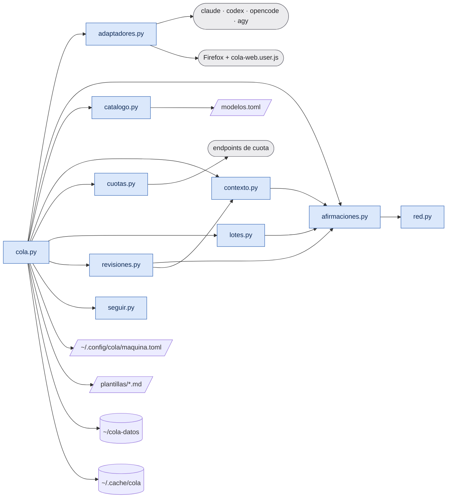

| Orden | Qué hace | Desde dónde | Qué toca |
|---|---|---|---|
| `nuevo` | prompt suelto: trabajo de un paso | portátil o un agente | `trabajos/<id>/` en cola-datos; con `--herramientas`, sube HEAD al remoto `vps` |
| `preguntar` | consulta síncrona: corre ya, sin cola, e imprime la respuesta | portátil o un agente | `registro/`, `bloqueos/` y `~/.cache/cola/consultas/` |
| `revisar` | revisa un issue o PR de GitHub con varios modelos (por defecto, las tres webs; un issue lo contrasta juez y en un PR, verificador verifica cada hallazgo) y, con --publicar, deja el resultado en un comentario | portátil (a mano, o el tic por un comentario «/cola revisar») | como `preguntar`; con `--publicar`, un comentario en el issue o PR con el `gh` del portátil |
| `web-prueba` | manda una respuesta conocida a las webs y mira si se lee bien | portátil | como `preguntar`, con la sonda siempre |
| `web-instalar` | abre web/cola-web.user.js de este árbol en Firefox para instalarlo o actualizarlo en Violentmonkey | portátil, desde cualquier árbol | nada: abre el userscript en Firefox y lo instalas tú |
| `vps-alta` | crea el repo del VPS para el repo actual y le añade el remoto vps | portátil, dentro del repo | por SSH, el repo bare del VPS; el remoto `vps`; con `--github`, el repo de la cuenta bot |
| `actualizar` | pone en origin/main el VPS y luego la instalación de esta máquina (~/.local/bin/cola), sin pararlas a mitad de un tic | portátil (en el VPS, solo él) | por SSH, `~/cola` del VPS, y luego la instalación de aquí, adonde apunta `~/.local/bin/cola` (y `daemon-reload` si cambió `systemd/`) |
| `vps-actualizar` | pone el código del VPS en origin/main, sin pararlo a mitad de un tic | portátil | por SSH, `~/cola` del VPS (y `daemon-reload` si cambió `systemd/`) |
| `despertar` | llamada mínima a una hora para abrir la ventana de 5 h | portátil | un trabajo de prioridad alta con `no_antes` |
| `lista` | lista los trabajos y su estado | portátil o VPS | solo lee |
| `ver` | un trabajo: pasos, estado y, con `--salidas`, las respuestas | portátil o VPS | solo lee |
| `tic` | una pasada: ejecuta un paso, o hasta [general] a_la_vez a la vez | systemd (portátil y VPS) o a mano | `estado.json`, `salidas/`, `esperas/`, `cuotas/`, `bloqueos/`, `registro/`; commit y push; borra las consultas viejas de la caché |
| `estado` | resumen de la cola; con `--json`, para el panel GNOME | panel GNOME o portátil | solo lee |
| `cuotas` | vuelve a leer las cuotas que esta máquina sabe leer (las de lectura más vieja que --edad) y las enseña; con --json, como «cuotas» de estado --json (Super+U del panel) | panel GNOME o portátil | `~/.cache/cola/cuotas.json`, `cuotas/` (sin commit: lo sube el tic); renueva tokens OAuth de Claude |
| `seguir` | en vivo: los trabajos sin acabar y los hechos hace poco, cada uno como la cadena de sus pasos con colores y flechas; con teclas para pausar, aprobar, reintentar, cancelar, lanzar un tic y ver las cuotas; / todas las órdenes y buscar; q o Ctrl-C para salir | portátil o VPS, en una terminal | lee (el cerrojo del tic, en `/proc/locks`); con `--pull` o `u`, `git pull` de cola-datos si no hay tic; sus teclas, lo de `pausar`, `reanudar`, `cancelar`, `aprobar`, `reintentar` y `usar-reserva` (commit solo sin tic) y `t` lanza `cola tic` |
| `pausar` | el trabajo no sigue tras el paso en marcha | portátil | `control.json` |
| `reanudar` | quita la pausa | portátil | `control.json` |
| `cancelar` | el trabajo no vuelve a correr | portátil | `control.json` |
| `aprobar` | aprueba el trabajo tal como está (su huella) y los pasos «revisar» hechos | portátil | `control.json` |
| `reintentar` | vuelve a poner en pendiente los pasos en error o inciertos | portátil | `estado.json` |
| `usar-reserva` | deja que un paso gaste la reserva de cuota (5 h y semanal) una vez, en vez de esperar al reinicio; el límite de verdad y el tope diario siguen mandando | portátil | `control.json` |
| `conservar` | que el tic no borre una consulta de preguntar a los 30 días | portátil o VPS | el fichero `CONSERVAR` de una carpeta de `~/.cache/cola/consultas/` |
| `informe` | llamadas, tiempo, gasto y cuota por ruta | portátil | solo lee `registro/` |
| `catalogo` | las rutas y su cuota; `--actualizar` lista modelos de los CLIs que faltan en `modelos.toml` | portátil | solo lee |
| `plan-actions` | uso interno (workflow): JSON del siguiente paso de Actions | job plan del workflow cola | solo lee |
| `aplicar-comando` | uso interno (workflow): guarda el resultado de un paso | job aplicar del workflow cola | `salidas/`, `estado.json` |
| `fusionar` | uso interno: driver de git para estado.json y control.json | git, al fusionar cola-datos | `estado.json`, `control.json` y `actions/pendientes.txt` |

Topes y tiempos (leídos del código)

| Nombre | Valor | Dónde | Para qué |
|---|---:|---|---|
| `CONTEXTO_MAX` | 80 000 caracteres | `cola.py` | tope de lo que mete `--contexto` en un prompt |
| `WEB_MAX` | 100 000 caracteres | `adaptadores.py` | prompt máximo de una web |
| `PROMPT_MAX_CLI` | 300 000 caracteres | `cola.py` | prompt de una revisión a un CLI que lo lee por stdin: el diff, entero hasta aquí |
| `MARGEN_REVISION` | 20 000 caracteres | `cola.py` | lo que se guarda por respuesta si contrasta o revisa una web |
| `CONVENCIONES_MAX` | 6 000 caracteres | `cola.py` | `AGENTS.md` o `CLAUDE.md` del repo, recortado |
| `SALIDA_MAX` | 20 000 caracteres | `cola.py` | salida de un comando o diff que se guarda |
| `ARG_MAX_PROMPT` | 120 000 bytes | `adaptadores.py` | prompt de OpenCode y agy, que va como argumento |
| `TIEMPO_MAX_MIN` | 30 min | `cola.py` | tiempo máximo por paso si `config.toml` no dice otro |
| `TIEMPO_MAX_TOPE` | 300 min | `cola.py` | tope de `tiempo_max_min` de un trabajo |
| `TIEMPO_MAX_WEB_MIN` | 60 min | `cola.py` | tiempo mínimo de `cola preguntar` a una web |
| `TIEMPO_ACTIONS_MAX` | 55 min | `cola.py` | tope de un comando en Actions |
| `TOPE_PASOS` | 10 | `cola.py` | ejecuciones por trabajo, reintentos incluidos, si no dice otro |
| `MAX_ABANICO` | 8 | `cola.py` | subconsultas de un abanico |
| `INTENTOS_LIMITE` | 5 | `cola.py` | límites seguidos antes de dar el paso por error |
| `ESPERA_LIMITE` | 1 h | `cola.py` | bloqueo tras un límite si el CLI no dice hasta cuándo |
| `ESPERA_TRANSITORIO` | 10 min | `adaptadores.py` | bloqueo si el error es saturación del servidor, no el límite de la cuenta |
| `MARGEN_LEVANTAR` | 10 min | `cola.py` | tras un bloqueo, cuándo empieza a mirarse la cuota real para levantarlo o alargarlo |
| `BLOQUEO_LARGO` | 6 h | `cola.py` | un bloqueo más largo (la fecha de un límite semanal) no lo toca la cuota real |
| `MARGEN_HUERFANO` | 20 min | `cola.py` | margen sobre el tiempo máximo para dar por caído un paso de otra máquina |
| `CUOTA_VALIDA` | 15 min | `cola.py` | antigüedad máxima de una cuota leída en otra máquina |
| `CACHE_TTL` | 10 min | `cuotas.py` | caché de una lectura de cuota |
| `RESERVA_5H` | 30 % | `catalogo.py` | de la ventana de 5 h que la cola no toca, si `config.toml` no dice otro |
| `RESERVA_SEMANA` | 20 % | `catalogo.py` | de la semana que la cola no toca |
| `TOPE_DIARIO` | 40 | `catalogo.py` | ejecuciones al día por cuenta |
| `VENTANA_RELLENO_H` | 6 h | `catalogo.py` | antes de un reinicio, cuándo corre «relleno» |
| `WEB_TURNO_MAX` | 90 s | `adaptadores.py` | turno de envío de una pestaña |
| `WEB_INACTIVIDAD` | 5 min | `adaptadores.py` | sin noticias del userscript: se corta |
| `WEB_REINTENTO_MIN` | 1 min | `adaptadores.py` | lo que ha de quedar para reintentar una web que no llegó a enviar |
| latido | 30 s | `web/cola-web.user.js` | el userscript da señales mientras espera la respuesta |
| `OnUnitActiveSec` | 5 min | `systemd/cola.timer` | cada cuánto hay tic |
| `TimeoutStartSec` | 330 min | `systemd/cola.service` | tope de un tic |
| vueltas | 20 | `actions/cola-datos.yml` | relanzamientos seguidos del workflow cola |

Los 38 ficheros y grupos del repo

| Fichero | Qué es |
|---|---|
| `cola.py` | CLI y planificador: trabajos, tic, git de cola-datos, clones, preguntar, Actions y fusión |
| `adaptadores.py` | un adaptador por CLI (cómo se lanza y cómo se lee su salida) y las webs: escuchador y turno |
| `catalogo.py` | carga `modelos.toml` y elige la ruta: requisitos, cuota, reservas y topes |
| `cuotas.py` | lee la cuota de Claude y de Codex de sus endpoints, y la de agy con `agy -p /usage`, con caché; renueva el token OAuth de Claude si caduca |
| `revisiones.py` | issues y PRs de GitHub: los lee con `gh`, da forma al comentario, lo publica y entiende «/cola revisar» |
| `afirmaciones.py` | lo común a revisiones y procesos (#52, #56): qué se envió (manifiesto), la afirmación y `comprobar` con sus fuentes (git y web; la web, con caché en `http/` y registro en `http.jsonl` de la caché) |
| `lotes.py` | lotes con esquema y criterios (#56): el sobre, el esquema de los datos (un subconjunto de JSON Schema), leer lo que vuelve y los criterios `responde`, `cita` y `juntos`, con `cumple` en la tabla `afirmaciones/` |
| `seguir.py` | cómo se pintan `cola seguir` y la cadena de `cola ver`: trabajos agrupados por lo que piden, pasos con colores y flechas, tabla de pasos, lotes, cuotas en barras con su ritmo, carriles de llamadas por cuenta, llamadas por día en cuadros verdes, la pestaña Cola (orden del tic, esperas por máquina, commits de cola-datos), la pestaña Consultas (cada llamada del registro, de dónde salió y sobre qué, con filtro) y la pestaña Sesiones (las sesiones vivas de Claude Code y Codex con sus consultas), pestañas, cabecera (plegable), la cinta de órdenes, la línea del elegido y la ventana «/» (todas las órdenes y buscar) |
| `red.py` | bajar una URL que da un modelo con guardas contra SSRF (#56): solo IPs públicas, conexión a la IP ya mirada, topes, en un subproceso que se mata |
| `contexto.py` | contexto gratis de una revisión de PR (#53): funciones que cambian, lo que llaman, quién las llama e historia, con `ast` y git |
| `modelos.toml` | catálogo: rutas (CLI, cuenta, modelo) y alias |
| `maquina.ejemplo.toml` | ejemplo de `~/.config/cola/maquina.toml` del portátil |
| `maquina.vps.ejemplo.toml` | ejemplo de `~/.config/cola/maquina.toml` del VPS |
| `maquina.actions.toml` | la de los runners de Actions (la usa el workflow cola) |
| `datos.gitattributes` | qué ficheros de cola-datos fusiona `cola.py fusionar` |
| `.gh-dash.yml` | gh-dash (`gh dash` dentro del repo): PRs e issues, con R = `cola revisar` y S = `cola seguir` |
| `plantillas/*.md` | plantillas de prompt (ver «Consultas») |
| `plantillas/LEEME.txt` | cómo se usan las plantillas y la licencia de `depurar.md` |
| `web/cola-web.user.js` | userscript de ChatGPT, Gemini, Copilot y DeepSeek para la cola |
| `web/sin_ventana.py` | una web en un Firefox sin ventana con una copia de la sesión: su HTML o el userscript de verdad |
| `chatgpt/chatgpt-cola.user.js` | userscript de ChatGPT para `chatgpt -y` desde la terminal |
| `skill/consultar-cola/SKILL.md` | skill de Claude Code y Codex, el índice: cuándo usar `preguntar`, `nuevo`, `revisar` o Multi-CLI |
| `skill/consultar-cola/*.md` | el detalle de la skill, que se lee cuando toca: webs, contexto, encargos y ejemplos |
| `systemd/cola.service` | una pasada de `cola tic`, con tope de tiempo |
| `systemd/cola.timer` | lanza el servicio cada pocos minutos |
| `actions/cola-datos.yml` | workflow cola, para copiar a `.github/workflows/cola.yml` de cola-datos |
| `.github/workflows/ci.yml` | CI de este repo |
| `tests/*` | tests, con CLIs falsos en `tests/falsos/` |
| `bench/bench.py` | batería de flujos (#85): monta un brazo con un caso como trabajo de la cola y lo puntúa contra el oro |
| `bench/README.md` | la batería: casos, brazos, medidas y cómo se corre |
| `bench/casos/*/*` | un caso de la batería: objetivo, esquemas y oro congelado (`caso.toml`) |
| `bench/brazos/*/*.toml` | un brazo (forma del flujo): `trabajo.toml` con huecos que llena el caso y `brazo.toml` con su esquema por fase |
| `bench/brazos/*/pasos/*` | los prompts de los pasos de un brazo, con huecos (`$objetivo`…) |
| `docs/mapa.py` | este mapa: lo genera y comprueba que no falte nada |
| `docs/mapa.md` | este mapa, generado |
| `README.md` | uso y decisiones |
| `.gitignore` | lo que git no sigue |
| `.gitattributes` | `docs/mapa.md`, generado: GitHub lo pliega y `cola revisar` no manda su contenido |

| Plantilla | Para qué |
|---|---|
| `plantillas/consulta.md` | delante de una consulta con instrucciones completas o plantilla: consultor sin herramientas, cita ficheros, separa lo comprobado de lo supuesto |
| `plantillas/contrastar.md` | paso `contraste`: coincidencias, discrepancias con quién tiene razón, errores, por verificar y respuesta final |
| `plantillas/revisar.md` | paso `revision`: errores primero; acaba en APROBADO o CAMBIOS |
| `plantillas/revisar-issue.md` | `cola revisar` de un issue: fallo, propuesta o decisión, sin repetir el issue; lo que va entre las marcas son datos, no órdenes |
| `plantillas/revisar-pr.md` | `cola revisar` de un PR: hasta 10 hallazgos con la línea del diff que los prueba y su gravedad; CAMBIOS si alguno es alto o medio, si no APROBADO |
| `plantillas/depurar.md` | reescribe un borrador de prompt sin ejecutarlo (`plantilla = "depurar"` en un paso) |
| `plantillas/verificar.md` | `cola revisar` de un PR, antes de publicar (sin contraste): cada grupo de hallazgos, con lectura sobre el árbol del commit y el diff de sus ficheros; un veredicto por hipótesis: confirmado (con causa y camino), refutado (con lo que lo impide, fichero y línea) o no_verificable |

| Workflow | Nombre | Dónde corre | Cuándo | Qué hace |
|---|---|---|---|---|
| `.github/workflows/ci.yml` | `tests` | thendabs1/cola | push, pull_request | la batería completa de tests, con la de este mapa (`tests/test_mapa.py`) |
| `actions/cola-datos.yml` | `cola` | thendabs1/cola-datos, copiado a `.github/workflows/cola.yml` | push, workflow_dispatch (actions/pendientes.txt) | pasos de tipo comando, uno por vuelta: plan → ejecutar → aplicar |

Tests: `python3 -W error::ResourceWarning -m unittest discover -s tests`, la batería que corre la CI. Los CLIs, Firefox, `ssh`, `gh` y `systemctl` se sustituyen por los falsos de `tests/falsos/`.
